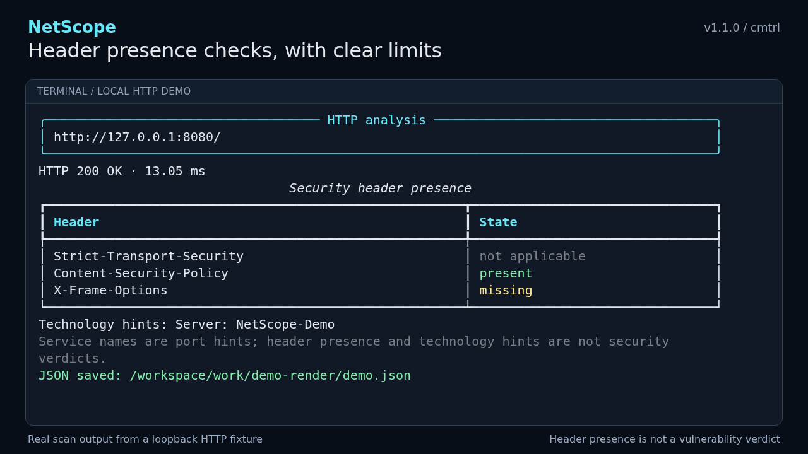

# NetScope

A Python CLI for checking DNS records, TCP ports, and HTTP headers.

By **cmtrl cmtrl** · [@cmtrl](https://github.com/cmtrl)

```text
 _   _      _   ____
| \ | | ___| |_/ ___|  ___ ___  _ __   ___
|  \| |/ _ \ __\___ \ / __/ _ \| '_ \ / _ \
| |\  |  __/ |_ ___) | (_| (_) | |_) |  __/
|_| \_|\___|\__|____/ \___\___/| .__/ \___|
                               |_|
```

I'm using this project to learn async Python and networking. It's still early,
and I plan to keep improving it as I learn. Bug reports and suggestions are welcome.

## Install

You'll need Python **3.11 or newer**. If you already use pipx:

```bash
pipx install cmtrl-netscope
```

Otherwise, install it in a virtual environment:

```bash
python -m venv .venv
source .venv/bin/activate
python -m pip install cmtrl-netscope
```

On Windows PowerShell, use `.venv\Scripts\Activate.ps1` to activate it.
To update, run `pipx upgrade cmtrl-netscope` or
`python -m pip install --upgrade cmtrl-netscope` in your virtual environment.

## Usage

```bash
netscope example.com
netscope example.com -p 22,80,443,8000-8005
netscope http://127.0.0.1:8080/health -p 8080
```

A bare hostname checks DNS, the common TCP ports, HTTP on 80, and HTTPS on 443.
A URL checks that HTTP endpoint, including its port and path. The `-p` option
sets the TCP ports; it accepts lists and ranges, up to 1024 ports.

Save the results to a file:

```bash
netscope example.com -o json --output-file report.json
```

Use `--json` for JSON on stdout, or `--verbose` to see all captured HTTP headers
in the terminal. The original `-t example.com` argument also works.

Run `netscope --help` for the remaining options, including timeouts and concurrency.

## Try it locally

With NetScope installed, start the included demo server:

```bash
netscope-demo
```

Leave that running. In a second terminal, activate the same environment and run:

```bash
netscope http://127.0.0.1:8080 -p 8080 -o json --output-file demo.json
```

You'll see port 8080 open, an HTTP 200 response, and the header checks. The server
leaves out X-Frame-Options so there's a missing header to show. HSTS doesn't apply
to plain HTTP, and DNS is skipped for the IP target. Press Ctrl+C in the server
terminal when you're done.

If 8080 is busy, start `netscope-demo --port 8081` and use 8081 in the scan too.



[Watch the demo](https://github.com/cmtrl/netscope/raw/refs/heads/main/docs/assets/netscope-demo-x.mp4)
· [Run or record your own](https://github.com/cmtrl/netscope/blob/main/docs/DEMO.md)

## Reading the results

An open port means a TCP connection succeeded. The service label is a hint based
on the port number. Technology headers are whatever the server reports.

The security-header checks look for HSTS, CSP, and X-Frame-Options. They check
presence, not whether a policy is useful or correctly configured. A missing
header alone isn't proof of a vulnerability.

HTTPS certificates are verified, and redirects are shown without being followed.
Cookie and authentication response headers are redacted in reports by default;
`--show-sensitive-headers` includes their values when you need them.

Use this on systems you own or have permission to check. The
[reference](https://github.com/cmtrl/netscope/blob/main/docs/REFERENCE.md)
covers DNS record types, result states, proxy behavior, JSON fields, and exit codes.

## Development

Clone the repository, create a virtual environment, then install from source:

```bash
git clone https://github.com/cmtrl/netscope.git
cd netscope
python -m venv .venv
source .venv/bin/activate
python -m pip install -e .
python -W error -m unittest discover -s tests -v
```

The tests use local DNS, HTTP, and TLS servers. The
[CI workflow](https://github.com/cmtrl/netscope/actions/workflows/ci.yml)
also checks installation on Linux, Windows, and macOS.

See [CONTRIBUTING.md](https://github.com/cmtrl/netscope/blob/main/CONTRIBUTING.md)
for development checks and the [changelog](https://github.com/cmtrl/netscope/blob/main/CHANGELOG.md)
for release notes.

## Credits

NetScope's initial implementation, tests, and documentation were developed with
assistance from OpenAI Codex. Project direction and maintenance by cmtrl
cmtrl (@cmtrl).

## License

[MIT](https://github.com/cmtrl/netscope/blob/main/LICENSE) · Copyright (c) 2026 cmtrl cmtrl (cmtrl).
